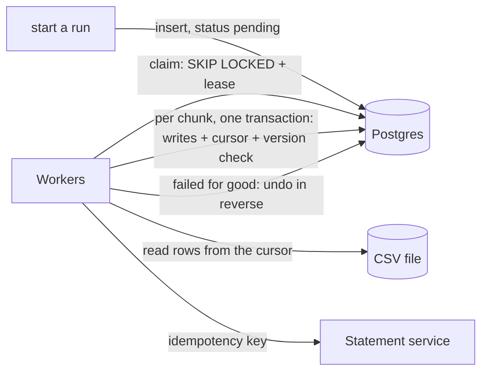
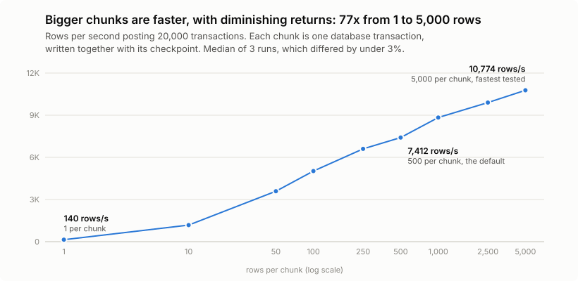

# Crash-safe batch

A small TypeScript library that runs long batch jobs in checkpointed steps. Kill the worker at any
moment, start another, and the job finishes with output identical to a run that was never
interrupted. If a later step fails for good, the finished steps are undone.

[](https://github.com/Hameesmahmood/crash-safe-batch/actions/workflows/ci.yml)

**A 50,000-row ledger import, run 10 times while workers were killed with `SIGKILL` 2,194 times
(404 of them while holding the job): all 10 results identical to an uninterrupted run, 0 duplicate
entries.** With the statement service failing, so that every run ended by undoing the whole import,
5 of 5 runs still matched through 2,806 kills. [Results and how to rerun them](docs/RESULTS.md).

## The problem

Long batch jobs fail halfway: a deploy restarts the process, the machine runs out of memory, a
downstream service goes away. Rerunning from the start wastes time and, worse, applies the first
half twice. Resuming by hand ("it got to about row 30,000, I think") is guesswork.

Tools like Temporal and Azure Durable Functions solve this by saving progress as they go. This
project does the same for one common shape of job, a sequence of steps where some steps work
through a large input in chunks, and shows what those tools do underneath.

The worked example imports 50,000 transactions from a CSV into a ledger, builds a statement per
account, then notifies a statement service. Each entry records the account's running balance, so a
row that is skipped, posted twice or posted out of order changes the result.

```ts
const ledgerImport = defineWorkflow("ledger-import", [
  batchStep("post", {
    size: 500,
    source: (input, from) => readTransactions(input.file, from), // rows after the cursor
    handle: postTransactions,
    compensate: reverseTransactions,
  }),
  step("summarise", { run: buildStatements, compensate: voidStatements }),
  step("notify", { attempts: 5, run: (ctx) => notifyStatementService(url, ctx) }),
]);
```



## Try it

You need Docker and Node 22.18 or later. Start Postgres, then run the demo:

```bash
docker compose up -d --wait
npm ci
npm run demo
```

It imports the 50,000 rows once without interruption, for comparison, then again with a real worker
process that it kills with `SIGKILL` partway through. This is the output of a run on 19 November:

```
1. 50,000 transactions to import, from data/tx-50000-42.csv
   An uninterrupted import, run first for comparison, has digest dccf830b0be87391

2. Run 1 queued. Worker A (pid 26656) starts posting it in chunks of 500.

3. Worker A killed with SIGKILL. It had no chance to finish its chunk or clean up.
   Last checkpoint: row 20,000. Anything A wrote after that rolled back with its open transaction.
   The run still names A as its owner, with a lease that runs out in 2 s.

4. Worker B (pid 26710) starts and waits for A's lease to run out.
   B claimed the run 2.1 s later and resumed at row 20,000.

5. Run 1 succeeded.
   50,000 ledger entries for 50,000 distinct CSV lines: nothing skipped, nothing posted twice.
   The statement service received 1 request and accepted 1 batch.
   Digest of this run:              dccf830b0be87391
   Digest of the uninterrupted run: dccf830b0be87391

Identical: the crash left no trace in the result.
```

The digest is a SHA-256 over every ledger entry, balance and statement, leaving out generated IDs.

### Drive it yourself

```bash
npm run generate -- --rows 50000 --out data/tx.csv
npm run stub                          # the statement service, on port 4100 (add --fail 503 to watch an undo)
node src/cli.ts start data/tx.csv     # prints the run ID
node src/cli.ts worker                # Ctrl-C finishes the chunk, hands the run back, exits
node src/cli.ts status 1
node src/cli.ts digest
```

Start as many workers as you like. Kill them with `kill -9`, restart them, and compare the digest
with a clean run's.

### Rerun the measurements

```bash
npm run crash                         # 50,000 rows, 10 trials, random SIGKILLs (about 10 minutes)
npm run crash -- --notify-fails       # the same, but every run ends by undoing the whole import
npm run bench && npm run chart        # throughput against chunk size, and the chart below
```

<picture>
  <source media="(prefers-color-scheme: dark)" srcset="docs/results/bench-chart-dark.svg">
  
</picture>

## Key decisions

**The checkpoint commits with the work.** Each chunk's ledger entries, balance updates and the
run's new cursor are written in one transaction. A crash keeps all of them or none, so database
work is exactly once. That's why the crash test can demand identical output, not just "nothing lost".

**Optimistic locking, checked last.** Every write to a run is
`UPDATE runs ... WHERE id = $1 AND version = $2` and bumps the version. A worker that froze while
another took over finds its update matches no rows, and the whole chunk rolls back. The check comes
at the end of the transaction on purpose. Checking first would lock the run for the whole chunk,
which is pessimistic locking in disguise.

**Postgres is the queue.** Workers claim runs with `FOR UPDATE SKIP LOCKED` and hold a lease that
each checkpoint renews. A dead worker's run is claimed by another once the lease expires. One system
to run, and the claim, the work and the checkpoint all live in the same database.

**The cursor counts rows.** A batch step's progress is the number of input rows handled. On resume
the CSV is parsed again from the start and the first rows are skipped. Re-parsing is cheap next to
writing, a row count can't land mid-row the way a byte offset can, and workers can even use a
different chunk size mid-run.

**A state machine guards every status change.** `pending → running → succeeded`, or
`running → compensating → compensated`. `compensating → failed` happens only when an undo itself
fails for good, which needs a person. Finished runs are never claimed again.

**Sagas undo by reversing, never deleting.** If a step fails for good (it throws `PermanentError`, or
uses up its attempts), the finished steps are undone in reverse order. Undoing `post` writes a
reversing entry for each entry the ledger says was posted, the way a real ledger corrects itself. A
batch step that failed halfway undoes only the rows it committed. The undo is checkpointed exactly
like the forward pass, so a crash during it finishes the undo instead of doubling it.

**Outside calls are at-least-once.** Only database work can be exactly once. `notify` sends the same
idempotency key (`ledger-import/<run id>`) on every attempt, so the service can accept a repeat only
once. Server errors and timeouts are retried with exponential backoff and full jitter. A `4xx`
(other than `408` and `429`) fails for good straight away.

**Backpressure by pulling.** The CSV is streamed, and the worker pulls the next row only after the
previous chunk has committed. A slow database slows the reader down, and memory stays at one chunk
plus the stream's buffer however large the file is.

**Graceful shutdown hands the run back.** On `SIGTERM` or `SIGINT` the worker lets the current chunk
commit, then sets its lease to expire now, so another worker can resume immediately instead of
waiting out the lease. A 10-second deadline, or a second signal, exits anyway, which is still safe.

**Chunks of 500 by default.** Bigger chunks are faster (chart above), but every chunk is a
transaction holding account locks, rows in memory, and work lost if a worker dies mid-chunk. 500
gets about 70% of the best measured throughput with transactions about 7 times shorter than at 5,000 (67 ms against 464 ms).

## How it's tested

- **41 tests** (Vitest). The integration tests run against real Postgres 18 in Testcontainers, not
  mocks, because transactions and locking are what's being tested.
- **Each concept has a test that switches it off** and shows what breaks. The broken versions live
  only in the test folder:

  | Switched off | What the test shows |
  | --- | --- |
  | State machine | A worker picks up an already-undone run and posts all 2,000 rows again |
  | Checkpoint in the same transaction | A crash between the writes and the checkpoint posts a chunk twice |
  | Saga compensation | `notify` fails for good, and the balances stay changed with no statement sent |
  | Backpressure | The parser gets 19,800 rows ahead of the worker, against 1,605 with it on |
  | Optimistic locking | A stale worker posts rows another worker already posted |
  | Graceful shutdown | The run stays stuck with the stopped worker for its whole 30-second lease |

- **The tests were checked by breaking the real code.** 18 deliberate bugs were introduced one at a
  time, and the suite failed for every one, each time in the test you'd expect.
- **CI runs on every push:** the type check, the tests, and a 5,000-row crash test that fails the
  build on any mismatch.

## Honest limits

- **Steps run in order.** No branching or parallel steps. The only parallelism is across runs; one
  worker at a time holds a given run.
- **One database.** Many workers, but one Postgres. Every figure here comes from one laptop and
  compares settings with each other; none of it is production capacity.
- **The input file must not change, and every worker must be able to read it.** The run stores the
  file's path, and the cursor counts rows in that file. (The undo reads the ledger, not the file, to
  decide what to reverse.)
- **`notify` holds a database connection open during its HTTP call**, for up to its 5-second
  timeout, because it runs inside the step's transaction. Fine for one call per run; a step making
  many calls should write to an outbox instead.
- **`failed` runs need a person.** There's no tooling yet to inspect or retry a half-undone run.
- **No unique constraint on ledger entries, on purpose.** Production code would add one as a second
  line of defence. Here it would turn a duplicate into an error, and hide exactly what the crash test
  is trying to detect.
- **No UI or scheduler.** Runs start from the CLI or from code.

## Project layout

```
src/engine     workflow definitions, the state machine, the runner, and the run store (claims,
               checkpoints, compensation). Knows nothing about ledgers.
src/example    the ledger import: CSV source, posting and reversing, statements, the notify client,
               and the statement-service stub
src/db         migrations
src/cli.ts     start, worker, status, digest
test/          unit and integration tests, and the switched-off versions of each concept
tools/         demo, crash harness, benchmark, chart, CSV generator, stub runner
```

TypeScript on Node 22, run directly through Node's type stripping (no build step), with `pg` and
hand-written SQL, `csv-parse`, Vitest and Postgres 18. The
[implementation plan](docs/IMPLEMENTATION_PLAN.md) was written before any code.

## Running the tests

```bash
npm ci
npm test        # needs Docker, for a real Postgres via Testcontainers
```

## License

MIT
