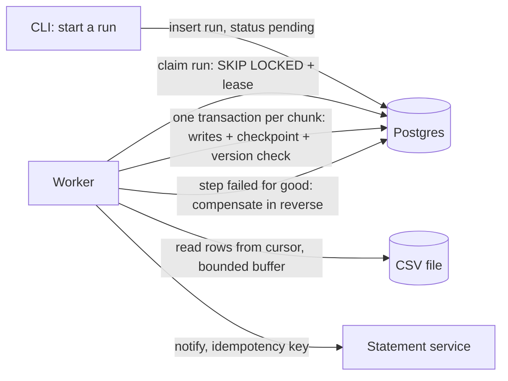

# Implementation plan: Crash-safe batch workflows

## The problem

Long batch jobs fail halfway: a deploy restarts the process, the machine runs out of memory, or a
downstream service goes away for good. Rerunning from the start wastes hours and, worse, applies the
first half twice. Resuming by hand ("it got to about row 30,000, I think") is guesswork.

Tools like Temporal and Azure Durable Functions solve this by saving progress as they go. This
project is a small TypeScript library that does the same for one common shape of job, a sequence of
steps where some steps work through a large input in chunks. It shows what those tools do underneath.

The worked example is a **ledger import**. 50,000 synthetic transactions from a CSV are posted to
accounts, a statement summary is built, and an external statement service is notified. Running
balances make the output order-sensitive, so any row that is skipped, applied twice or applied out of
order changes the result.

## Non-goals

- **Parallel or branching steps (DAGs).** Steps run in order. Fan-out happens only inside a batch step,
  as chunks.
- **More than one machine.** Several workers can run, but against one Postgres database. Leader
  election is out.
- **A UI or scheduler.** Runs start from a CLI or code.
- **Exactly-once external side effects.** Only database writes are exactly once. Calls to other
  systems are at-least-once with an idempotency key, and are compensated if they fail for good.
- **Fencing tokens as a separate feature.** The optimistic-lock version number already does this job,
  and Week 1 covered fencing.
- **A general CSV library.** Synthetic CSV only, with no quoted newlines.

## Design



**Workflows are code.** A workflow is a list of named steps. A *simple step* runs once. A *batch step*
reads rows from a source and handles them in chunks of N. Either kind can declare a `compensate`
function.

```ts
const ledgerImport = defineWorkflow("ledger-import", [
  batchStep("post", { source: csvRows, size: 500, handle: postTransactions, compensate: reverseTransactions }),
  step("summarise", { run: buildStatements, compensate: voidStatements }),
  step("notify", { run: notifyStatementService, attempts: 5 }),
]);
```

**The transactional checkpoint.** Every chunk runs in one transaction:

1. `UPDATE runs SET version = version + 1, cursor = $next, lease_expires_at = now() + lease
   WHERE id = $id AND version = $expected`. Zero rows means another worker owns the run, so roll back
   and stop.
2. The step's own writes for the chunk (ledger entries, balance updates).
3. `COMMIT`.

A crash at any point keeps both the writes and the checkpoint, or neither. Database work is therefore
exactly once, and a resumed run is indistinguishable from an uninterrupted one.

**State machine.** Run status follows `pending → running → succeeded`, or
`running → compensating → compensated` when a step fails for good. `compensating → failed` happens
only if an undo itself fails for good, which needs a human. A paused or crashed run returns from
`running` to the claimable pool when its lease expires. All transitions go through one function that
rejects illegal moves, and the SQL that changes status also checks the current status.

**Claiming and leases.** Workers claim a `pending` or lease-expired `running` run with
`FOR UPDATE SKIP LOCKED`. Every chunk commit extends the lease, so a live worker keeps its run. A dead
worker's run is picked up by another worker after the lease expires (30 s by default).

**Optimistic locking.** The version check in step 1 stops a stale worker, one that froze past its
lease while another worker took over, from committing its chunk. Postgres row locks serialise the two
updates, and the loser sees zero rows.

**Resuming.** A batch step's cursor is the number of input rows already handled. On resume the source
skips that many rows (csv-parse's `from_line`) and carries on. Re-parsing the skipped rows is cheap
next to writing them, and a row count is simpler and safer than a byte offset.

**Backpressure.** The CSV is read as a stream through an async iterator. The worker pulls the next
chunk only after the previous one commits, so the parser pauses whenever the database is behind.
Rows held in memory stay within one chunk plus the stream's small buffer, however large the file.

**Saga compensation.** If a step fails permanently (a non-retryable error, or `attempts` used up), the
run moves to `compensating`. The `compensate` functions of the finished steps run in reverse order.
For `post`, that means writing reversing ledger entries, never deleting, as a real ledger would. A
batch step's compensation is itself checkpointed and resumable, so a crash during compensation
finishes the undo, never doubles it.

**External calls.** `notify` sends the run ID as an idempotency key, so a retry after a crash is safe
for the receiver. The statement service is a small stub that can be told to fail.

**Graceful shutdown.** On `SIGTERM` or `SIGINT`, the worker stops pulling new chunks, lets the current
chunk commit, then releases its lease (`lease_expires_at = now()`) so another worker can claim the run
straight away. If the chunk doesn't finish within the shutdown deadline, the process exits anyway and
the transaction rolls back, which is still safe.

### Data model

- `runs`: `id`, `workflow`, `input` (jsonb), `status`, `step_index`, `cursor`, `version`,
  `lease_owner`, `lease_expires_at`, `attempt`, `error`, `created_at`, `updated_at`.
- `run_steps`: `run_id`, `step_index`, `status` (`done`, `compensated`), `compensate_cursor`. This
  records which steps finished, so compensation knows what to undo.
- The example's tables: `accounts` (`id`, `balance_cents`), `ledger_entries` (`run_id`, `line_no`,
  `txn_id`, `account_id`, `amount_cents`, `balance_after_cents`, `reverses_line_no`), `statements`.

`ledger_entries` has **no** unique constraint on `txn_id`, on purpose. Production code would add one
as a second line of defence. Leaving it out lets the crash test see a duplicate instead of turning it
into a constraint error.

### Code structure

- `src/engine/`: workflow definitions, state machine, runner, claiming, checkpoints, shutdown.
  It knows nothing about ledgers.
- `src/example/`: the ledger import workflow, CSV source and statement-service client.
- `src/cli.ts`: `start`, `worker` and `status` commands.
- `tools/`: CSV generator (seeded, deterministic), statement-service stub, crash harness, benchmark,
  chart script.
- `test/`: Vitest, with integration tests on real Postgres via Testcontainers.

The stack is TypeScript on Node 22, `pg` with hand-written SQL, `csv-parse`, Vitest and Postgres 18.

## Test plan

Each concept gets a test that switches it off and shows what breaks. The naive versions live only in
the test folder.

| Concept | With it | Switched off, this breaks |
| --- | --- | --- |
| State machine | A compensated run can't be resumed | A worker resumes a compensated run and posts every row again |
| Checkpointing (same transaction) | A crash between chunks loses nothing and repeats nothing | A checkpoint saved after the commit, in its own transaction: a crash in between applies the chunk twice |
| Saga compensation | `notify` fails for good, every posting is reversed and balances return to where they started | Balances stay changed with no statement sent |
| Backpressure | Rows in memory stay within a chunk plus a small buffer | The whole file is buffered in memory |
| Optimistic locking | A stale worker's chunk is rejected | A stale worker's chunk is applied a second time |
| Graceful shutdown | After `SIGTERM`, another worker resumes immediately and nothing is redone | The run is stuck until its lease expires |

## The measured result

**Crash test.** `tools/crash.ts` generates a 50,000-row CSV and runs the import once without
interruption, recording a SHA-256 hash of the output (ledger entries, balances and statements, in a
fixed order). It then runs the same import repeatedly while killing the worker with `SIGKILL` at
random moments and restarting it, until the run finishes. It compares each hash with the
uninterrupted one. It reports trials, kills, matches and mismatches, and the run fails on any
mismatch.

**Throughput against batch size.** `tools/bench.ts` runs the import with chunk sizes from 1 to 5,000
and records rows per second. A chart shows the curve. If time allows, a second panel shows rows
redone per crash at each size, which is the cost side of big chunks.

Results go in `docs/RESULTS.md` with the commands to rerun them. Everything runs on one laptop, so
the figures compare settings with each other. They don't measure production capacity.

## Definition of done

- One command runs the demo, and the README shows a run surviving a kill.
- Every row in the test plan has a passing test.
- CI runs the tests and a smaller crash test on every push, and every job passes.
- The 50,000-row crash test is published with its real match count, and a chart shows throughput
  against batch size.
- The README covers the problem, a demo, how to run it, key decisions and honest limits.
- The explain test is passed.

## Schedule (short week: Wednesday to Sunday)

- **Wednesday 11 Nov:** concepts, this plan, README pitch, skeleton, migrations, CSV generator and CI.
- **Thursday 12 Nov:** engine: state machine, claiming and leases, batch steps with the transactional
  checkpoint and optimistic locking, resume. The `post` step of the example.
- **Friday 13 Nov:** saga compensation, `summarise` and `notify`, the statement stub, backpressure,
  graceful shutdown, and the concept-off tests.
- **Saturday 14 Nov:** crash harness, benchmark, chart.
- **Sunday 15 Nov:** results, README, explain test and ship.

If time runs short, cut in this order: the rework panel of the chart, the statement stub as its own
process (use an in-process fake instead), then the `status` command.
