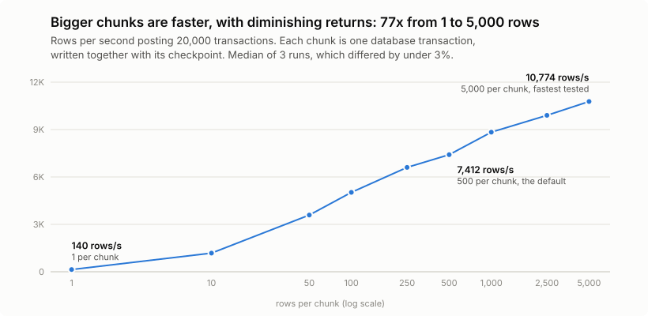

# Results

Two questions, each answered by a run you can repeat:

1. If workers are killed at random moments, again and again, does the job still finish with
   exactly the output of a run that was never interrupted?
2. What does the chunk size cost and buy?

Everything ran on one laptop (Postgres 18 in Docker, Node 22). The figures compare settings with
each other; they say nothing about production capacity.

## 1. The crash test

### Headline run

Commit `2b04288`, 18 November 2026. The raw output, including every trial, is in
[`results/crash-latest.json`](results/crash-latest.json).

| Measure | Result |
| --- | --- |
| Rows imported per run | 50,000 |
| Trials | 10 |
| **Trials identical to the uninterrupted run** | **10 of 10** |
| Workers killed with `SIGKILL` | 2,194 |
| Of those, killed while holding the run | 404 (31 to 51 per trial) |
| **Duplicate ledger entries** | **0** |
| Statement batches accepted by the service | 10, one per run |
| Uninterrupted run | 7.2 s |
| Interrupted runs | 45.2 s to 70.6 s |

**Rerun it:** `docker compose up -d --wait`, then `npm run crash` (about 10 minutes).

### The setup

`tools/crash.ts` first imports the CSV once, with one worker and no kills, and takes the digest
of the result. Then, for each trial, in a fresh database:

- **Two worker processes run at all times.** Each is a real `node src/cli.ts worker` process,
  killed with `SIGKILL` after a random lifetime between 0.1 s and 0.9 s and replaced at once.
  `SIGKILL` can't be caught, so a worker gets no chance to finish its chunk or hand the run back.
- **Short timings, so takeovers are quick:** 1-second leases, chunks of 500 rows, idle workers
  polling every 500 ms.
- **A fresh statement-service stub per trial**, counting every request and every batch it accepts.

When the run finishes, the harness takes the digest again: a SHA-256 over every ledger entry (CSV
line, transaction ID, account, amount, running balance, reversal flag), every account balance and
every statement, in a fixed order, leaving out generated IDs. A trial passes only if the run ended
in the expected state and its digest equals the uninterrupted run's. The harness exits non-zero on
any mismatch.

### Reading the numbers

**Why "identical", not just "nothing lost".** Each chunk's entries, balance updates and the run's
cursor commit in one transaction. A kill before the commit rolls back all of it, and the next worker
redoes that chunk from the last cursor. A kill after the commit loses nothing. There's no moment in
between, so there's nothing to duplicate. Week 1's webhook inbox couldn't promise this, because its
effect happened in another system.

**Why only 404 of the 2,194 kills hit a worker holding the run.** Only one worker can hold a run at
a time; the other is polling for work. And a fresh worker spends some of its short life starting up
(loading Node, connecting, checking migrations) before it can claim anything. A kill counts as
"holding" only if that worker had already claimed the run, so 404 is the number that tests resuming.

**Why interrupted runs took 6 to 10 times longer.** Each kill of the holding worker costs a lease
expiry (1 s), up to one poll interval for the other worker to notice, and the uncommitted chunk.
Across the 10 trials that works out to about 1.2 s of extra time per holding kill:
(56.2 s average − 7.2 s) ÷ 40.4 holding kills per trial.

**Why every run notified the service exactly once.** In these trials no kill happened to land in the
few milliseconds between `notify` getting its answer and its checkpoint committing. The repeat case
is covered by the test "sends the statements again after a crash, and the idempotency key makes the
service accept them once". In a smaller trial run while building the harness, `notify` was sent 4
times and accepted once.

### The same test, with every run ending in a full undo

Commit `c30f0f3`, 19 November 2026. Raw output:
[`results/crash-compensation.json`](results/crash-compensation.json).

Here the statement service refuses every request with `503`. Each run posts all 50,000 rows, builds
the statements, retries `notify` 5 times, then undoes everything: voids the statements and writes a
reversing entry for each posting. Workers were killed throughout, including during the undo.

| Measure | Result |
| --- | --- |
| Trials | 5 |
| **Trials identical to the uninterrupted (also undone) run** | **5 of 5**, all ending `compensated` |
| Workers killed with `SIGKILL` | 2,806 |
| Of those, killed while holding the run | 460 |
| Postings and reversals per run | 50,000 and 50,000 |
| **Duplicate postings or reversals** | **0** |
| Statement batches accepted | 0 (5 refused requests per run) |
| Uninterrupted run | 34 s |
| Interrupted runs | 111.1 s to 183.3 s |

**Rerun it:** `npm run crash -- --notify-fails --trials 5`.

The uninterrupted run takes 34 s, not 7, because it posts and reverses 50,000 rows and waits out
`notify`'s retry backoff (random, growing to up to 16 s).

### Other runs

| Run | Rows | Trials | Kills (holding the run) | Identical | Result |
| --- | --- | --- | --- | --- | --- |
| Commit `2b04288`, 18 Nov (headline) | 50,000 | 10 | 2,194 (404) | 10 of 10 | Pass |
| Commit `c30f0f3`, 19 Nov, every run undone | 50,000 | 5 | 2,806 (460) | 5 of 5 | Pass |
| CI on commit `6369f00`, 18 Nov | 5,000 | 3 | 114 (19) | 3 of 3 | Pass |

CI runs the 5,000-row version on every push.

### Checking the check

A test that always passes proves nothing, so the harness was also run against two deliberately
broken versions of the engine (the bug applied by hand, the run, then the code restored, so these
files record the commit as `c30f0f3-dirty`):

| Broken on purpose | Rows | Trials | Kills (holding the run) | Identical | Duplicate entries | Result |
| --- | --- | --- | --- | --- | --- | --- |
| Resume reads the CSV from row 0, ignoring the cursor | 5,000 | 3 | 3,199 (545) | 0 of 3 | 378,500 | Fail, as it should |
| Checkpoint saved in its own transaction, after the writes | 5,000 | 3 | 68 (12) | 3 of 3 | 0 | **Missed** |
| The same, at full size | 50,000 | 5 | 1,178 (210) | 0 of 5 | 6,500 | Fail, as it should |

The middle row is the honest limit of random killing. Splitting the checkpoint from the writes only
causes harm if a kill lands in the few milliseconds between the two commits. With 12 kills of a
worker holding the run, none did. At full size, 13 of 210 such kills landed in that gap, and each
posted a 500-row chunk twice. The test suite catches this bug every time, because the switched-off
test crashes exactly in that gap; the crash test is the end-to-end check, not the only one. It's
also why CI's small crash test complements the tests rather than replacing them.

Raw output: [`crash-broken-resume-from-zero.json`](results/crash-broken-resume-from-zero.json),
[`crash-broken-checkpoint-separate.json`](results/crash-broken-checkpoint-separate.json),
[`crash-broken-checkpoint-separate-50k.json`](results/crash-broken-checkpoint-separate-50k.json).

## 2. Throughput against chunk size

Commit `2b04288`, 18 November 2026. Raw output: [`results/bench-latest.json`](results/bench-latest.json).

<picture>
  <source media="(prefers-color-scheme: dark)" srcset="results/bench-chart-dark.svg">
  
</picture>

`tools/bench.ts` runs only the `post` step of 20,000 rows, in a fresh database each time, three
times at each chunk size, after one unrecorded warm-up run. It times from the claim to the end of
the step and reports rows per second.

| Rows per chunk | Transactions | Rows per second (median) | Slowest and fastest run | Time per transaction |
| --- | --- | --- | --- | --- |
| 1 | 20,000 | 140 | 139 to 140 | 7.1 ms |
| 10 | 2,000 | 1,182 | 1,180 to 1,204 | 8.5 ms |
| 50 | 400 | 3,591 | 3,569 to 3,674 | 13.9 ms |
| 100 | 200 | 5,027 | 4,990 to 5,103 | 19.9 ms |
| 250 | 80 | 6,606 | 6,579 to 6,674 | 37.8 ms |
| 500 (default) | 40 | 7,412 | 7,344 to 7,419 | 67.5 ms |
| 1,000 | 20 | 8,834 | 8,765 to 8,897 | 113 ms |
| 2,500 | 8 | 9,898 | 9,862 to 10,010 | 253 ms |
| 5,000 | 4 | 10,774 | 10,723 to 10,785 | 464 ms |

**Rerun it:** `npm run bench`, then `npm run chart` to redraw the chart.

### Reading the numbers

**Small chunks are dominated by fixed cost.** Every chunk is a transaction: insert any new
accounts, lock the chunk's accounts, insert the entries, update the balances, compare-and-set the
run's version, then commit, which waits for the write to reach disk. At one row per chunk that takes
7.1 ms, nearly all of it overhead, so throughput is 140 rows a second.

**Big chunks give diminishing returns.** From 1 to 100 rows per chunk, throughput rises 36 times.
From 500 to 5,000 (ten times bigger) it rises only 45%, because by then the per-row work dominates.
The curve was still rising at 5,000, the largest size tested, so this run doesn't show a peak.

**Why the default is 500 anyway.** Throughput isn't the only cost of a big chunk:

- **Work lost per crash.** A worker killed mid-chunk loses everything since its last commit. At 500
  rows that's at most about 0.07 s of work at these speeds; at 5,000 it's about 0.46 s. (This is
  arithmetic from the table, chunk size ÷ throughput, not a separate measurement.)
- **Locks held longer.** A chunk holds row locks on every account it touches until it commits.
  Other runs touching the same accounts wait.
- **The lease must outlast the slowest chunk.** If a chunk takes longer than the lease, another
  worker takes the run over mid-chunk and the first worker's commit is rejected.
- **Memory.** A chunk's rows are held in memory until it commits.

500 gets about 70% of the best measured throughput with transactions about 7 times shorter (67 ms
against 464 ms).

## What this doesn't show

- **Production capacity.** One laptop, everything local.
- **Database failure.** Only workers are killed. Postgres stays up throughout.
- **Network partitions.** Nothing here cuts a worker off from the database while it keeps running.
  The stale-worker case is covered by tests (a frozen worker whose lease expires), not by this run.
- **Graceful shutdown under load.** The harness only uses `SIGKILL`. The `SIGTERM` path is covered by
  tests and was checked by hand with real processes: a worker stopped at row 21,500 handed the run
  back at once, and a second worker resumed at row 21,500 and finished with the same digest.
